# Native iPad visual review

**Actual SwiftUI application screenshots, using explicitly synthetic test data. Not staging verification.** All frames carry the NOT-STAGING banner. No supplied staff credentials or customer data appear. Empty product imagery uses the app's neutral fallback; these are not invented food photos.

Full-size CoreSimulator originals are retained in the linked Actions artifacts. Review copies are normalized by quarter-turn only; no UI pixels are generated, retouched or cropped. Selected upright PNGs are committed here so reviewers can inspect them without downloading a result bundle. Source metadata accompanies each image directory.

## Before and after

### Menu and order builder

A narrower sidebar returns space to the catalogue. Product prices and category selection have stronger emphasis. The cart separates the filled submission action from local draft saving, groups optional notes/promotion, and pins its action rail while items scroll.

| Before | After |
|---|---|
| 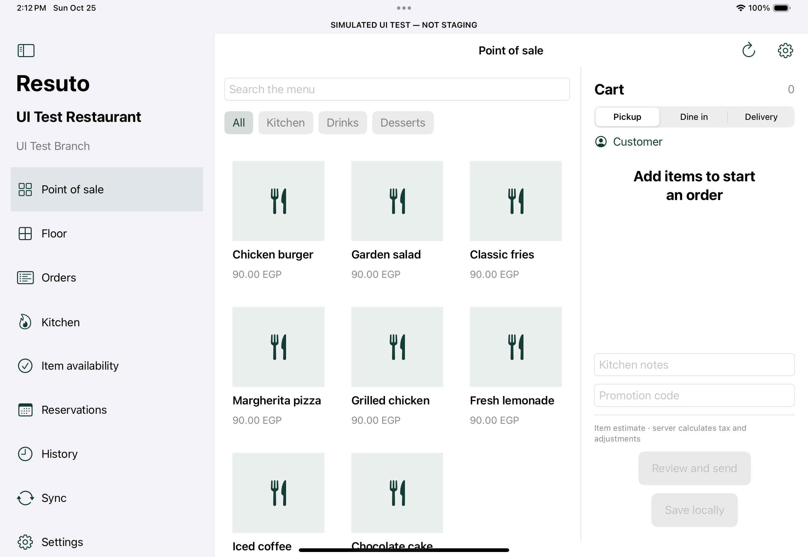 | 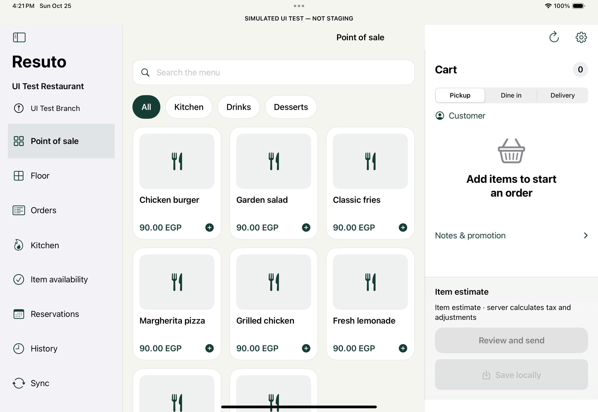 |

### Product choices

The item estimate, required/optional choices and primary action remain visible without using a small toolbar button. The updated range copy describes what staff must select; server modifier validation is unchanged.

| Before | After |
|---|---|
| 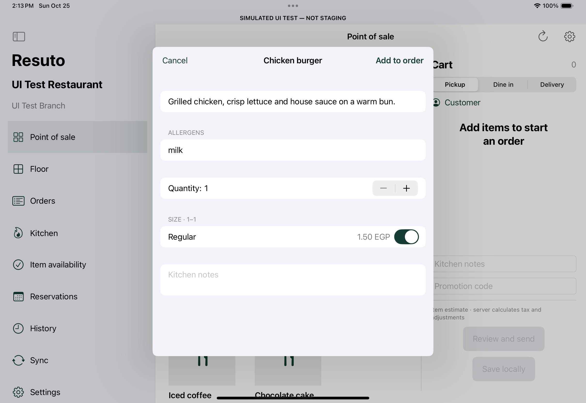 | 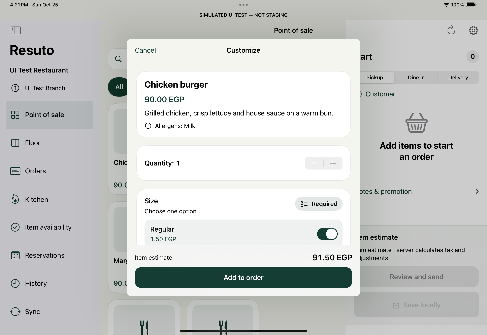 |

### Cash checkout

The server-confirmed due amount and cash action appear before the full price audit. The breakdown remains expandable. Confirmation still requires an online server response; a local tap cannot mark an order paid.

| Before | After |
|---|---|
| 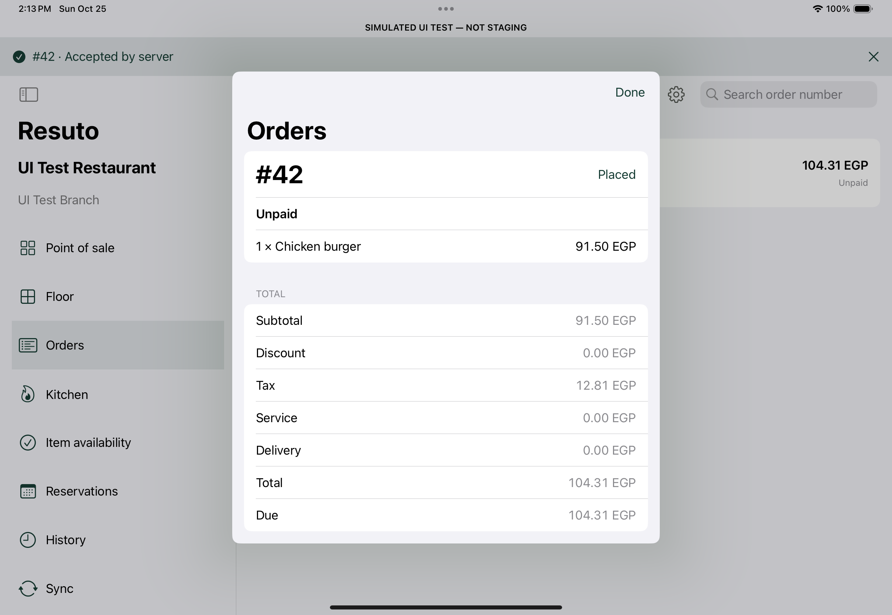 | 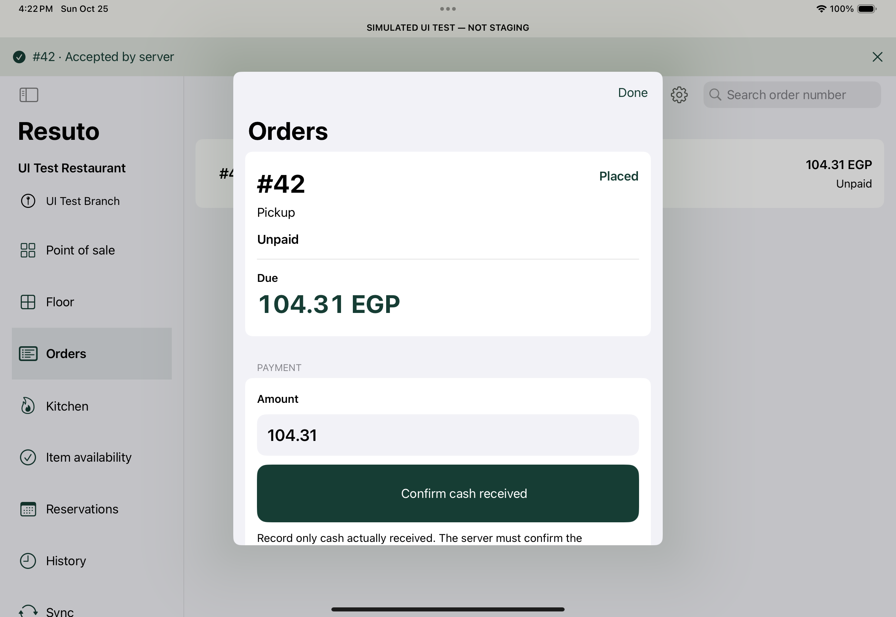 |

## Staff access and workspace

Explicit credential labels and readable staff context; restaurant, role and branch choices have distinct cards. Sensitive sign-in contents are not captured.

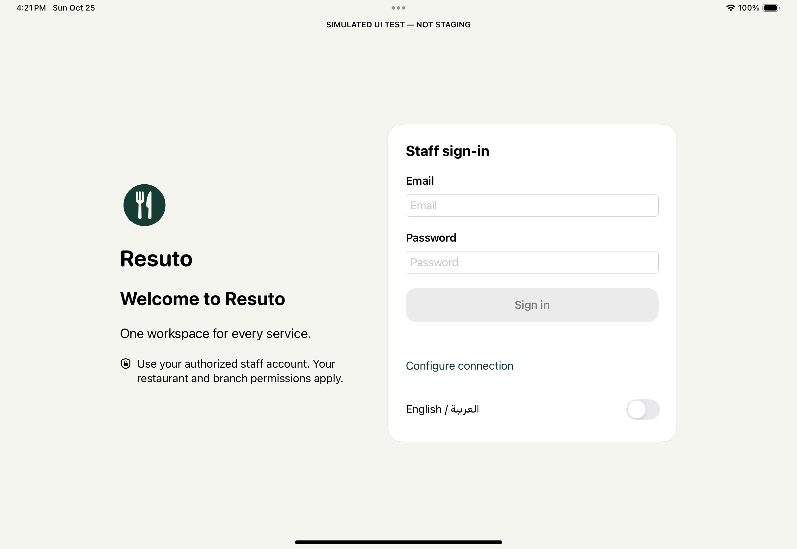

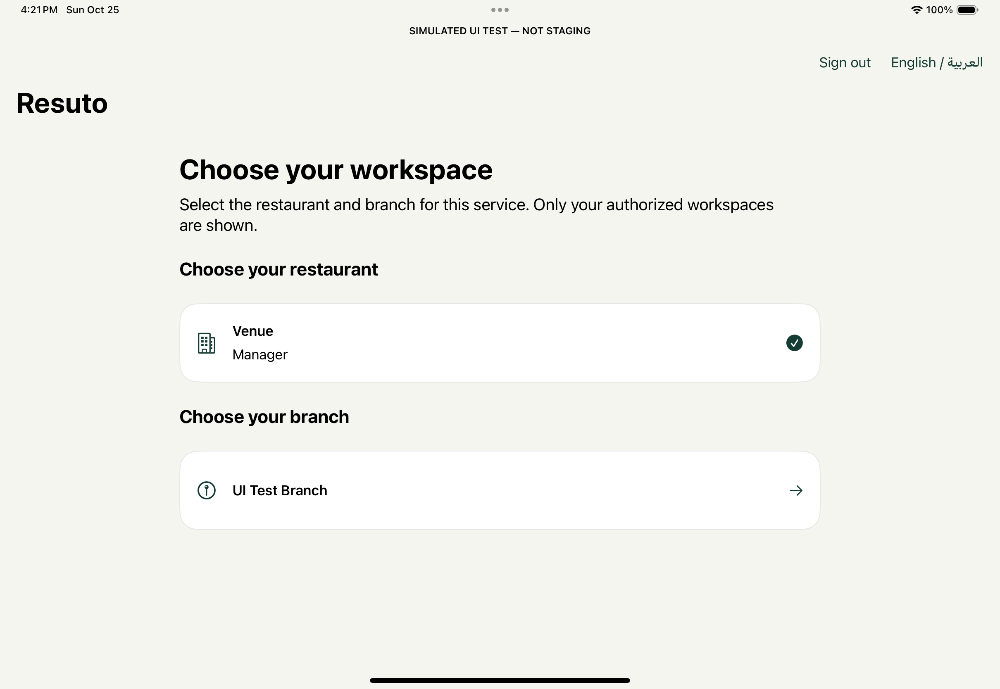

## Arabic ordering

Native RTL catalogue/cart, readable Arabic labels and Western money digits. The sheet environment explicitly follows the selected language. Recognized allergen tokens are translated; unknown server descriptions are preserved instead of guessed or removed.

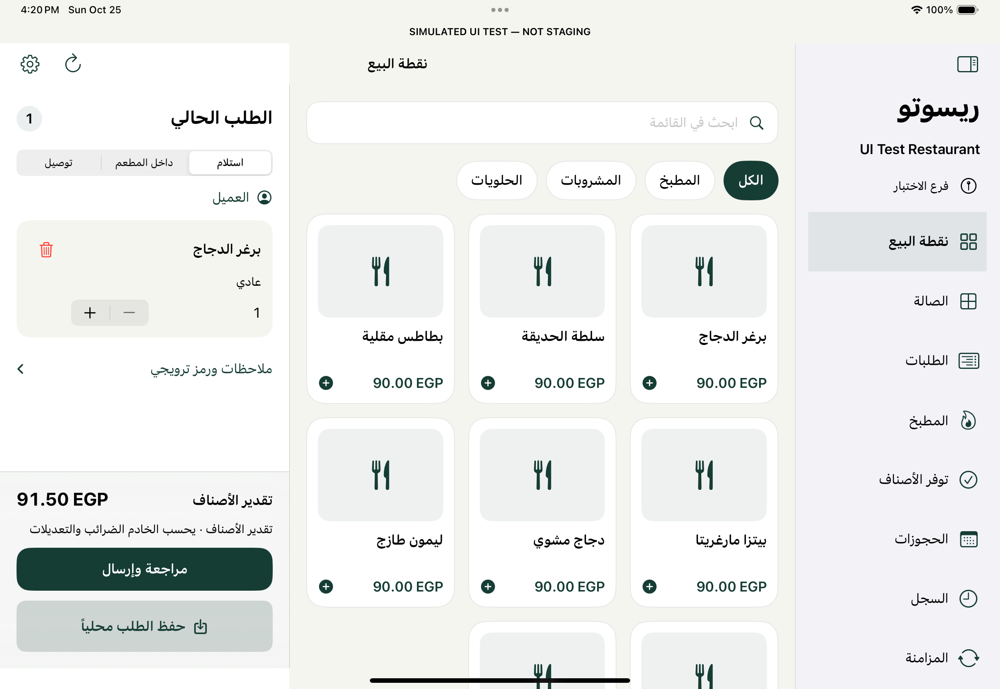

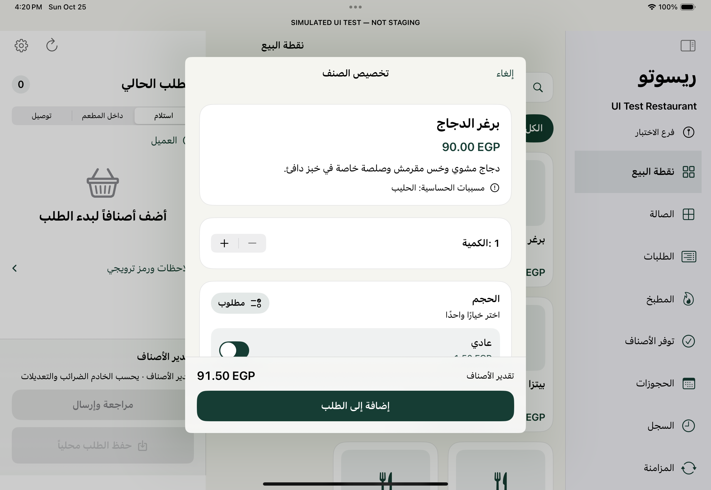

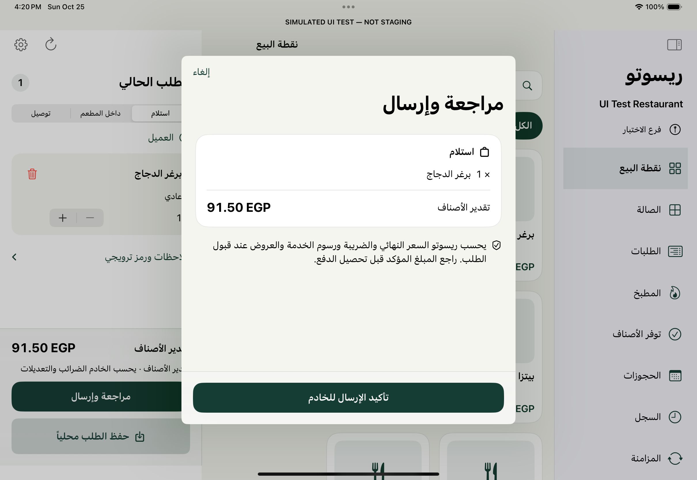

## Operational screens

Kitchen status comes from server responses. The floor preserves actual spatial coordinates and has an accessible table-list alternative. Sync distinguishes saved drafts from accepted orders and warns that financial recovery needs review. Device linking remains in read-only validation until staging acceptance permits native write cutover.

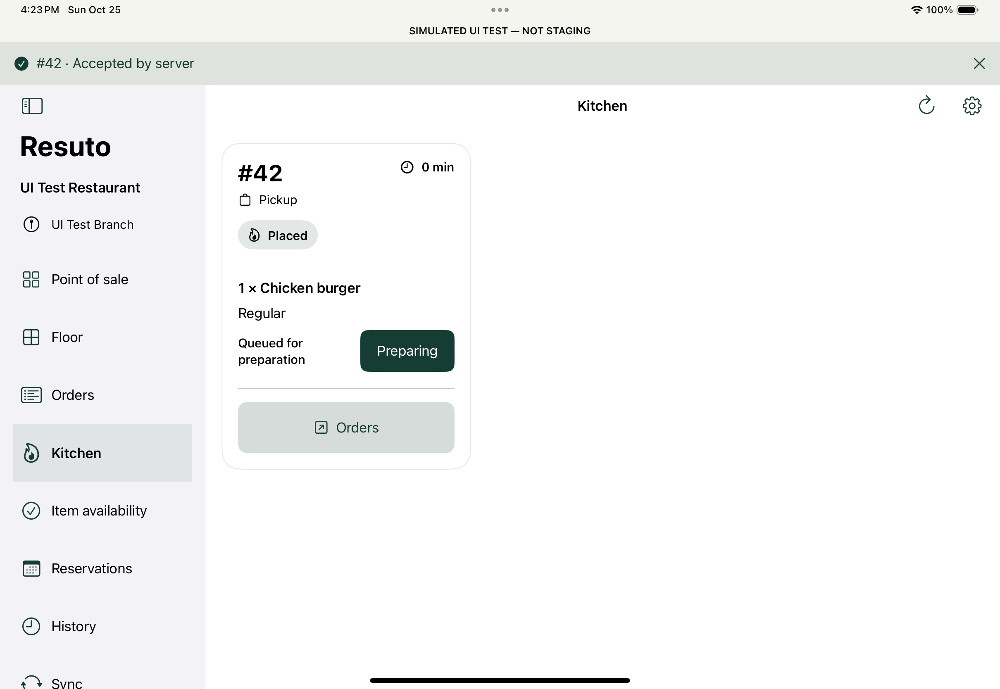

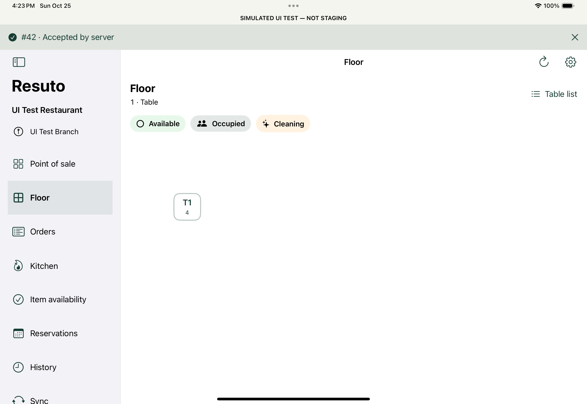

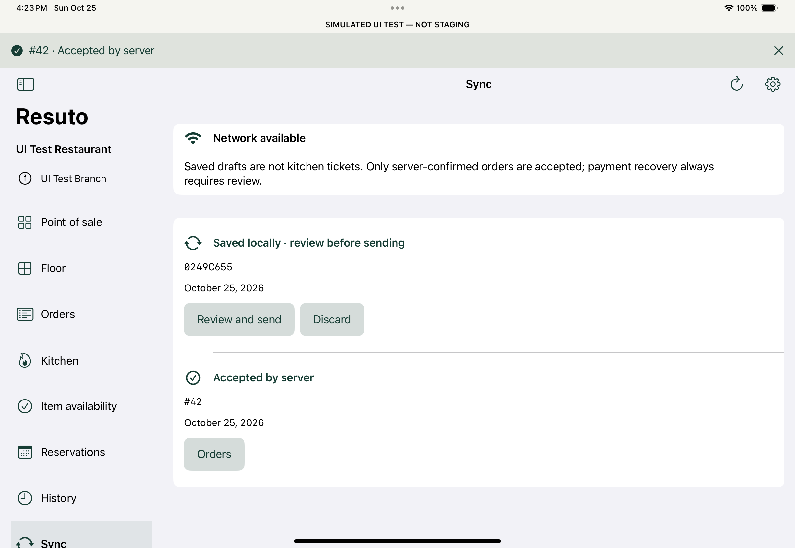

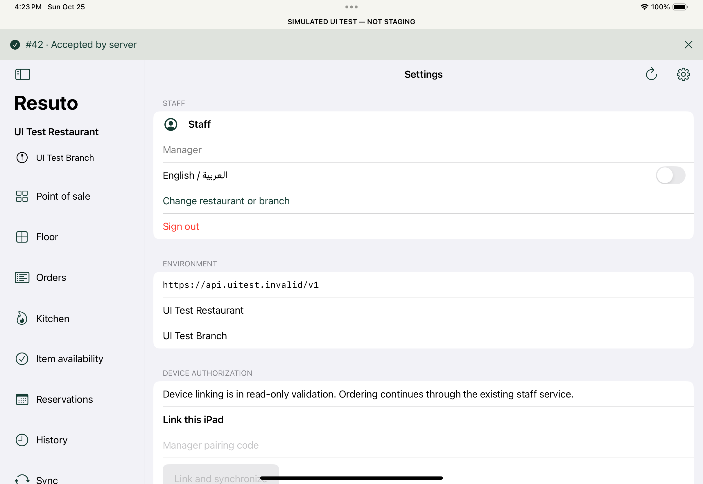

## Evidence and limitations

Baseline: [run 40200247954](https://github.com/MoAlazool/ResutoGDG/actions/runs/40200247954), source `8e4c175`, 19 full captures. This capture-only revision preserves the earlier application UI.

After: [run 40210274577](https://github.com/MoAlazool/ResutoGDG/actions/runs/40210274577), source `42263eb`, all 107 core and 21 UI tests passed. All 19 after frames were inspected; twelve selected final frames are embedded above. Full metadata/checksums are recorded in `images/ux-20261025/after/source.json` and `VERIFICATION.md`. See `UX_REVIEW.md` for findings and design references. Screenshots and synthetic tests do not establish full accessibility compliance, dark-appearance acceptance, real-device performance, payment settlement, paper output, or authenticated iPad → API → Web Orders → KDS → financial/inventory/analytics convergence.
