# Database ERD

Generated by `node scripts/db/erd.mjs` from the migrated schema — do not edit by hand.

105 tables; 105 with row-level security enabled. Every tenant table carries `org_id`; branch-scoped tables also carry `branch_id`. Money columns end in `_minor` (integer minor units).

## Tenancy & platform

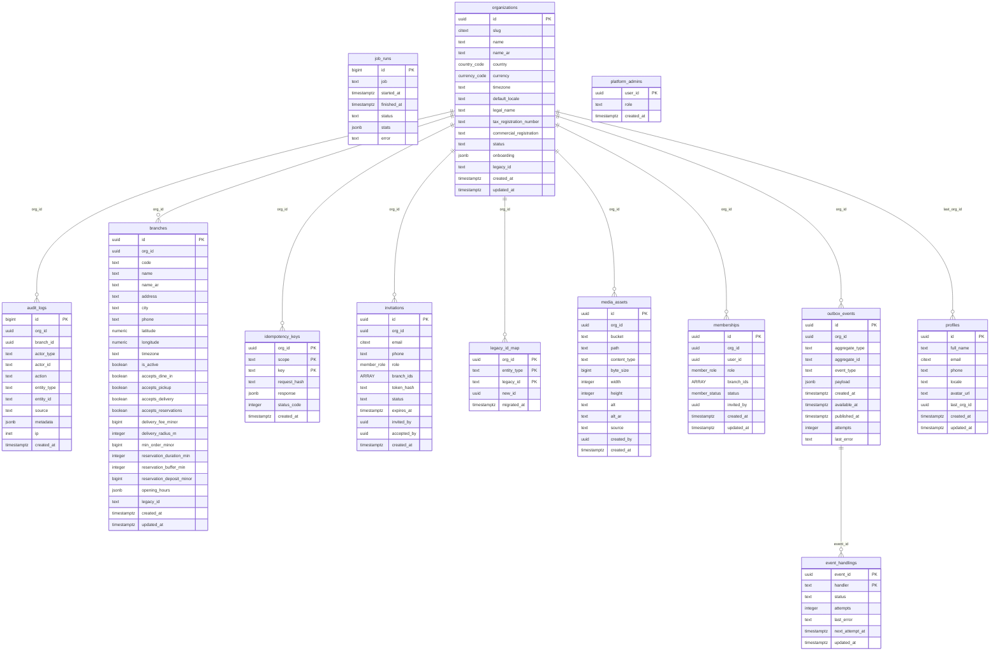

## Billing

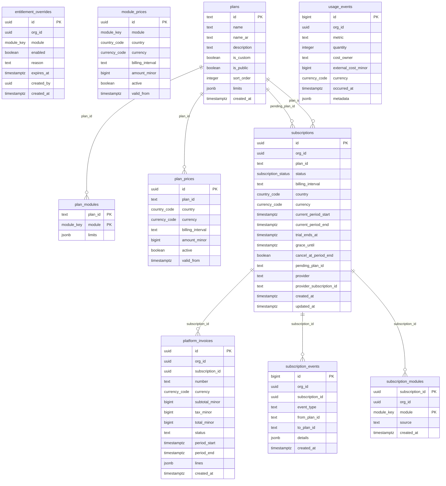

## Catalog & floor

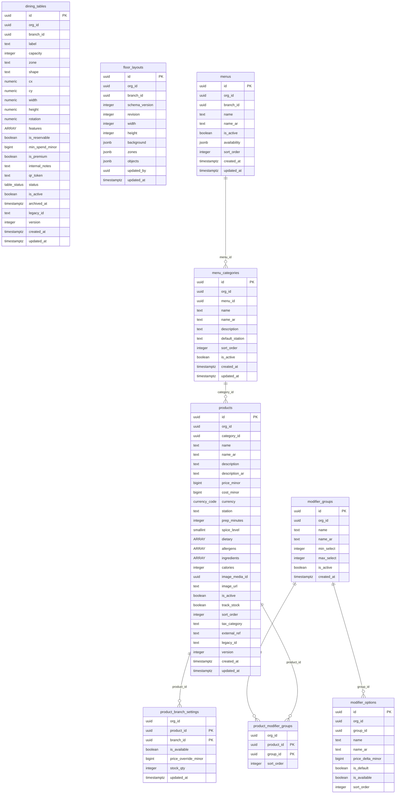

Cross-domain references: `product_branch_settings.branch_id` → `branches`, `products.image_media_id` → `media_assets`, `dining_tables.branch_id` → `branches`, `menus.branch_id` → `branches`, `floor_layouts.branch_id` → `branches`.

## Orders, visits & reservations

```mermaid
erDiagram
  order_counters {
    uuid branch_id PK
    uuid org_id
    date day
    integer value
  }
  order_events {
    bigint id PK
    uuid org_id
    uuid order_id
    text event_type
    text from_status
    text to_status
    text actor_type
    text actor_id
    jsonb details
    timestamptz created_at
  }
  order_lines {
    uuid id PK
    uuid org_id
    uuid order_id
    uuid product_id
    text name
    text name_ar
    bigint unit_price_minor
    integer quantity
    jsonb modifiers
    bigint modifiers_total_minor
    bigint line_total_minor
    bigint cost_minor
    text station
    kitchen_status kitchen_status
    text notes
    timestamptz created_at
    timestamptz updated_at
  }
  orders {
    uuid id PK
    uuid org_id
    uuid branch_id
    text number
    date business_date
    text public_ref
    order_channel channel
    fulfillment_type fulfillment
    order_status status
    payment_status payment_status
    uuid visit_id
    uuid table_id
    uuid customer_id
    text customer_name
    text customer_phone
    jsonb delivery_address
    currency_code currency
    bigint subtotal_minor
    bigint discount_minor
    bigint delivery_fee_minor
    bigint service_charge_minor
    bigint tax_minor
    boolean tax_inclusive
    bigint total_minor
    bigint paid_minor
    bigint refunded_minor
    text notes
    timestamptz scheduled_for
    uuid promotion_id
    uuid campaign_id
    jsonb attribution
    uuid conversation_id
    timestamptz placed_at
    timestamptz accepted_at
    timestamptz ready_at
    timestamptz fulfilled_at
    timestamptz cancelled_at
    text cancel_reason
    text external_ref
    text legacy_id
    integer version
    timestamptz created_at
    timestamptz updated_at
  }
  reservations {
    uuid id PK
    uuid org_id
    uuid branch_id
    uuid table_id
    uuid customer_id
    text code
    text access_token_hash
    text guest_name
    text guest_phone
    citext guest_email
    integer party_size
    timestamptz starts_at
    timestamptz ends_at
    timestamptz blocked_until
    reservation_status status
    timestamptz hold_expires_at
    bigint deposit_minor
    deposit_status deposit_status
    bigint deposit_credit_used_minor
    text source
    text notes
    uuid seated_visit_id
    text legacy_id
    timestamptz created_at
    timestamptz updated_at
  }
  service_requests {
    uuid id PK
    uuid org_id
    uuid branch_id
    uuid visit_id
    text kind
    text status
    timestamptz created_at
    timestamptz resolved_at
  }
  visits {
    uuid id PK
    uuid org_id
    uuid branch_id
    uuid table_id
    uuid reservation_id
    uuid customer_id
    integer party_size
    text status
    text guest_token_hash
    uuid opened_by
    timestamptz opened_at
    timestamptz closed_at
    uuid closed_by
    text legacy_id
    bigint credit_minor
    bigint credit_used_minor
  }
  reservations ||--o{ visits : "reservation_id"
  visits ||--o{ service_requests : "visit_id"
  visits ||--o{ reservations : "seated_visit_id"
  orders ||--o{ order_lines : "order_id"
  visits ||--o{ orders : "visit_id"
  orders ||--o{ order_events : "order_id"
```

Cross-domain references: `visits.branch_id` → `branches`, `visits.customer_id` → `customers`, `visits.table_id` → `dining_tables`, `service_requests.branch_id` → `branches`, `reservations.branch_id` → `branches`, `reservations.customer_id` → `customers`, `reservations.table_id` → `dining_tables`, `order_lines.product_id` → `products`, `orders.branch_id` → `branches`, `orders.campaign_id` → `campaigns`, `orders.conversation_id` → `conversations`, `orders.customer_id` → `customers`, `orders.promotion_id` → `promotions`, `orders.table_id` → `dining_tables`, `order_counters.branch_id` → `branches`.

## Customers & inventory

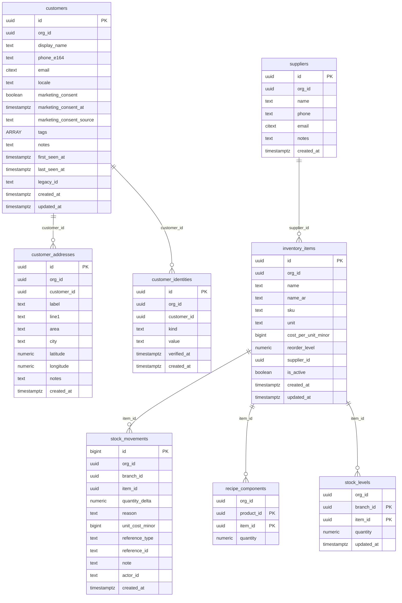

Cross-domain references: `stock_movements.branch_id` → `branches`, `recipe_components.product_id` → `products`, `stock_levels.branch_id` → `branches`.

## Payments & finance

```mermaid
erDiagram
  bill_shares {
    uuid id PK
    uuid org_id
    uuid split_id
    text label
    bigint amount_minor
    bigint paid_minor
    ARRAY line_ids
    text status
    text participant_token_hash
    timestamptz created_at
  }
  bill_splits {
    uuid id PK
    uuid org_id
    uuid branch_id
    uuid visit_id
    uuid order_id
    text mode
    integer parts
    bigint total_minor
    currency_code currency
    text status
    timestamptz created_at
  }
  checkout_sessions {
    uuid id PK
    uuid org_id
    uuid branch_id
    text token_hash
    text purpose
    uuid order_id
    uuid visit_id
    uuid share_id
    uuid reservation_id
    bigint amount_minor
    currency_code currency
    text description
    ARRAY allowed_methods
    text status
    text provider
    text provider_session_id
    text provider_url
    text return_url
    text channel
    uuid customer_id
    timestamptz expires_at
    timestamptz paid_at
    timestamptz created_at
    timestamptz updated_at
  }
  expense_categories {
    uuid id PK
    uuid org_id
    text name
    text name_ar
    text kind
  }
  expenses {
    uuid id PK
    uuid org_id
    uuid branch_id
    uuid category_id
    bigint amount_minor
    bigint tax_minor
    currency_code currency
    date incurred_on
    text vendor
    text description
    text payment_method
    uuid receipt_media_id
    text source
    text external_ref
    uuid created_by
    timestamptz created_at
    timestamptz updated_at
  }
  financial_exports {
    uuid id PK
    uuid org_id
    text kind
    text format
    date period_start
    date period_end
    integer row_count
    text checksum
    text destination
    uuid connection_id
    text status
    uuid created_by
    timestamptz created_at
  }
  payment_allocations {
    bigint id PK
    uuid org_id
    uuid payment_id
    uuid order_id
    bigint amount_minor
    text kind
    timestamptz created_at
  }
  payments {
    uuid id PK
    uuid org_id
    uuid branch_id
    uuid order_id
    uuid visit_id
    uuid reservation_id
    uuid share_id
    uuid checkout_session_id
    payment_method method
    text provider
    uuid connection_id
    text provider_payment_id
    bigint amount_minor
    currency_code currency
    bigint fee_minor
    bigint net_minor
    payment_attempt_status status
    bigint refunded_minor
    text idempotency_key
    boolean is_test
    uuid received_by
    uuid driver_id
    text failure_reason
    timestamptz captured_at
    jsonb raw
    text legacy_id
    timestamptz created_at
    timestamptz updated_at
  }
  reconciliation_items {
    uuid id PK
    uuid org_id
    uuid run_id
    uuid payment_id
    text provider_txn_id
    bigint expected_minor
    bigint actual_minor
    bigint fee_minor
    text status
    text resolution
    text notes
  }
  reconciliation_runs {
    uuid id PK
    uuid org_id
    uuid branch_id
    text provider
    timestamptz period_start
    timestamptz period_end
    text status
    text source
    jsonb totals
    uuid created_by
    timestamptz created_at
    timestamptz completed_at
  }
  refunds {
    uuid id PK
    uuid org_id
    uuid payment_id
    bigint amount_minor
    text reason
    text status
    text provider_refund_id
    text idempotency_key
    uuid created_by
    timestamptz created_at
    timestamptz completed_at
  }
  payments ||--o{ payment_allocations : "payment_id"
  bill_splits ||--o{ bill_shares : "split_id"
  bill_shares ||--o{ checkout_sessions : "share_id"
  checkout_sessions ||--o{ payments : "checkout_session_id"
  bill_shares ||--o{ payments : "share_id"
  expense_categories ||--o{ expenses : "category_id"
  payments ||--o{ refunds : "payment_id"
  payments ||--o{ reconciliation_items : "payment_id"
  reconciliation_runs ||--o{ reconciliation_items : "run_id"
```

Cross-domain references: `payment_allocations.order_id` → `orders`, `bill_splits.branch_id` → `branches`, `bill_splits.order_id` → `orders`, `bill_splits.visit_id` → `visits`, `checkout_sessions.branch_id` → `branches`, `checkout_sessions.customer_id` → `customers`, `checkout_sessions.order_id` → `orders`, `checkout_sessions.reservation_id` → `reservations`, `checkout_sessions.visit_id` → `visits`, `payments.branch_id` → `branches`, `payments.connection_id` → `integration_connections`, `payments.driver_id` → `drivers`, `payments.order_id` → `orders`, `payments.reservation_id` → `reservations`, `payments.visit_id` → `visits`, `expenses.branch_id` → `branches`, `expenses.receipt_media_id` → `media_assets`, `financial_exports.connection_id` → `integration_connections`, `reconciliation_runs.branch_id` → `branches`.

## Delivery

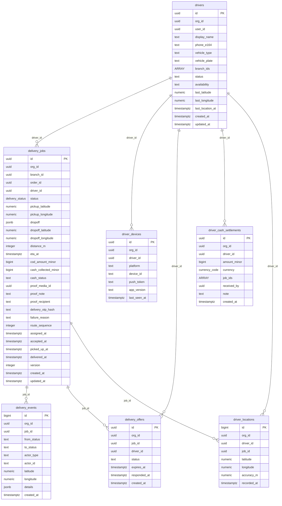

Cross-domain references: `delivery_jobs.branch_id` → `branches`, `delivery_jobs.order_id` → `orders`, `delivery_jobs.proof_media_id` → `media_assets`.

## Compliance

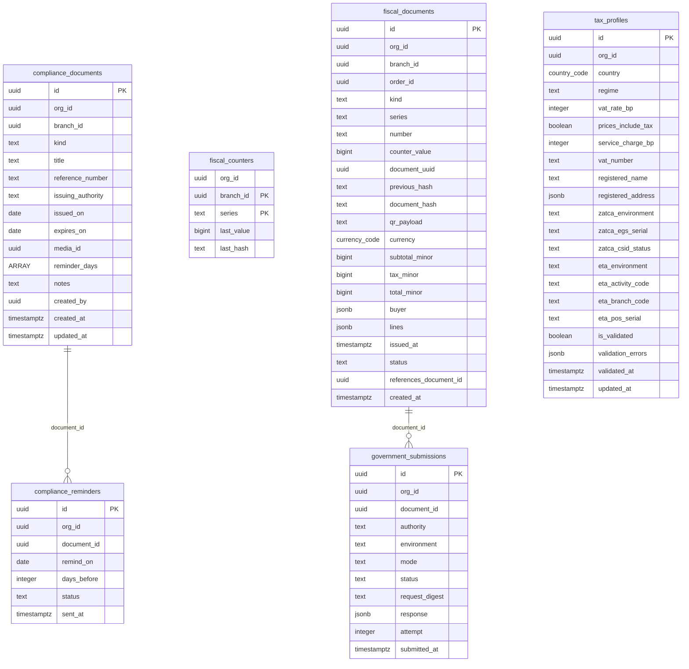

Cross-domain references: `fiscal_counters.branch_id` → `branches`, `fiscal_documents.branch_id` → `branches`, `fiscal_documents.order_id` → `orders`, `compliance_documents.branch_id` → `branches`, `compliance_documents.media_id` → `media_assets`.

## Connect & marketing

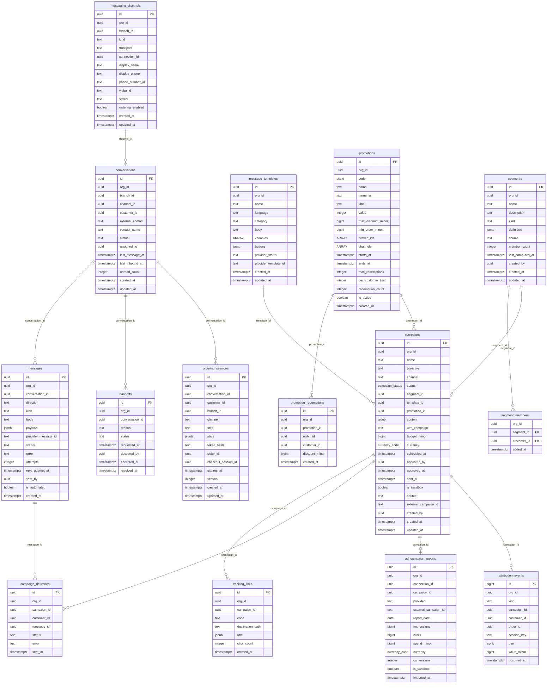

Cross-domain references: `conversations.branch_id` → `branches`, `conversations.customer_id` → `customers`, `segment_members.customer_id` → `customers`, `messaging_channels.branch_id` → `branches`, `messaging_channels.connection_id` → `integration_connections`, `ordering_sessions.branch_id` → `branches`, `ordering_sessions.checkout_session_id` → `checkout_sessions`, `ordering_sessions.customer_id` → `customers`, `ordering_sessions.order_id` → `orders`, `promotion_redemptions.customer_id` → `customers`, `promotion_redemptions.order_id` → `orders`, `campaign_deliveries.customer_id` → `customers`, `ad_campaign_reports.connection_id` → `integration_connections`, `attribution_events.customer_id` → `customers`, `attribution_events.order_id` → `orders`.

## Studio

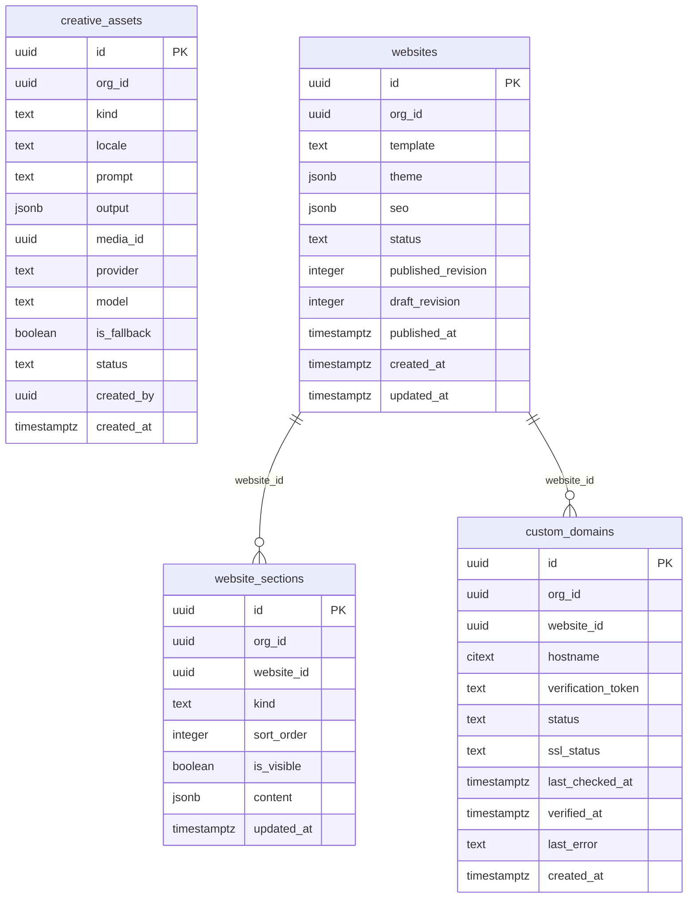

Cross-domain references: `creative_assets.media_id` → `media_assets`.

## Integrations

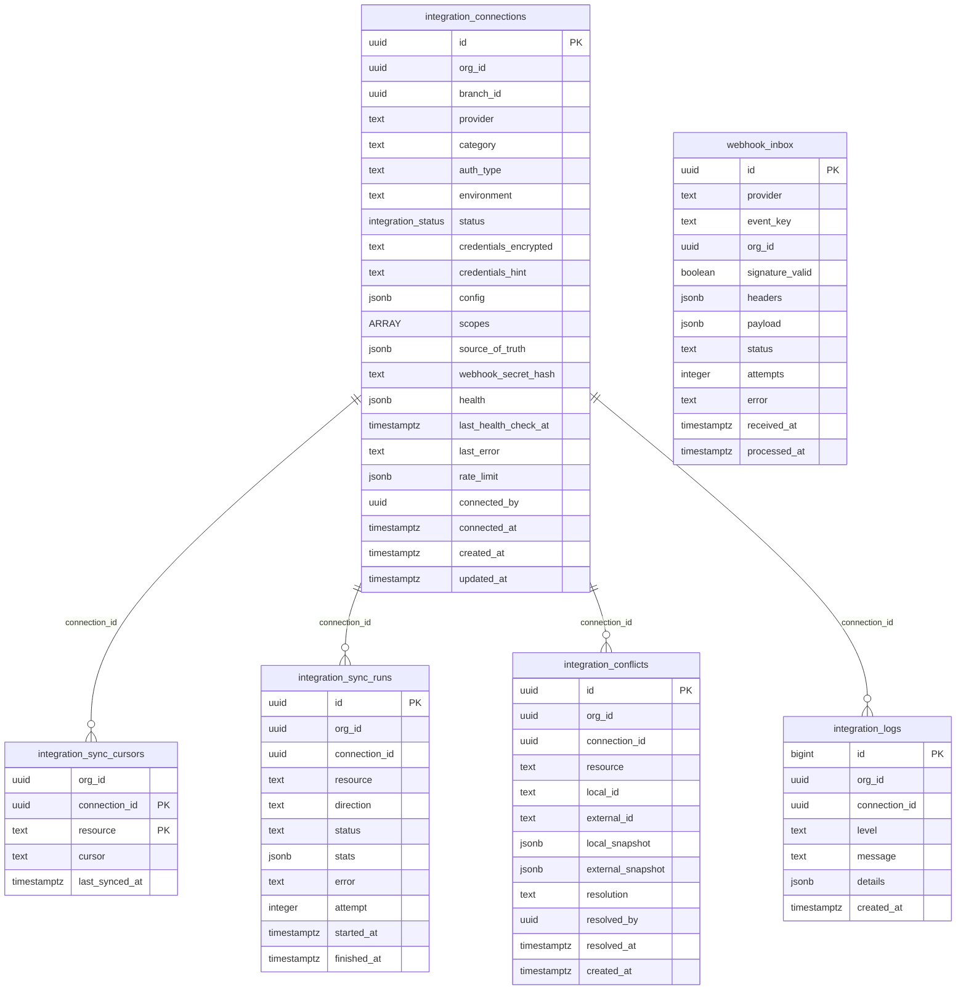

Cross-domain references: `integration_connections.branch_id` → `branches`.

## Intelligence & MCP

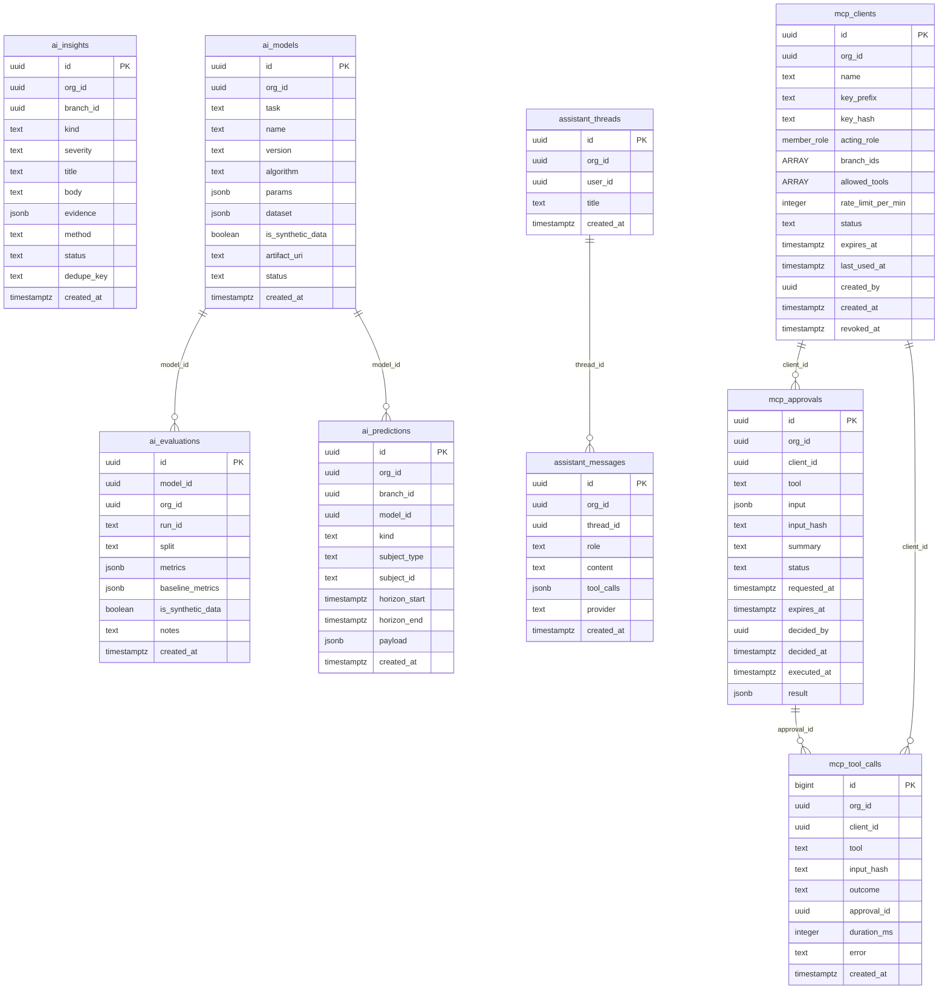

Cross-domain references: `ai_predictions.branch_id` → `branches`, `ai_insights.branch_id` → `branches`.

